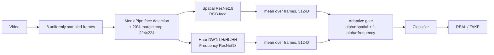

# Multimedia Authentication

Deepfake **video** detection that combines **spatial** (RGB) and **frequency** (Haar DWT) features, each extracted with a ResNet18, and fuses them with an adaptive gate. Trained and evaluated on a subset of FaceForensics++ (C23).

> **Research prototype.** It is a mini-project, not a production detector. See [Results](#results) and [Limitations](#limitations) for what it can and cannot do.

<!-- Add a screenshot at docs/demo_screenshot.png, then uncomment: -->
<!--  -->

## Pipeline



## Quick start

```bash
git clone https://github.com/kirtisrivastava22/Multimedia-authentication.git
cd Multimedia-authentication
pip install -r requirements.txt
python app.py
```

Model weights live in `weights/` (see [weights/README.md](weights/README.md) for how they are created). The face-detector model is downloaded automatically on the first run.

Check that the video path matches the training preprocessing:

```bash
python scripts/sanity_check.py clip.mp4 faces/clip.npz
```

## Repository layout

```
app.py                 Gradio demo
src/models/            ResNet18 branch + gated fusion head
src/preprocessing.py   Frame sampling, face crop, DWT (mirrors training)
src/inference.py       DeepfakeDetector (video -> REAL/FAKE)
scripts/               export_weights.py, sanity_check.py
notebooks/             01-10: the full experiment, in order
results/               Metrics, curves, confusion matrices
splits/                Train/val/test split used
weights/               Exported model weights
```

## Dataset

FaceForensics++ (C23): original videos plus Deepfakes, Face2Face, FaceSwap, FaceShifter and NeuralTextures (DeepFakeDetection was excluded).
Frames and faces were extracted for **2,647 of the 6,000** videos (train 1,770 / val 392 / test 418 after face detection; about 84% FAKE). Splits are grouped by source video ID (70/15/15). The dataset is not included in this repository.

## Method

1. **Frames:** 8 uniformly spaced frames per video.
2. **Faces:** MediaPipe BlazeFace, 20% margin, resized to 224x224.
3. **Spatial branch:** ImageNet-pretrained ResNet18 fine-tuned on RGB faces.
4. **Frequency branch:** single-level Haar DWT; the LH, HL and HH sub-bands (averaged over RGB) are min-max normalised and fed to a ResNet18.
5. **Video features:** mean of the 8 frame-level 512-D features per branch.
6. **Fusion:** compared a concatenation head ("fixed fusion") with an adaptive gated head.
7. **Loss:** class-weighted cross-entropy for the REAL/FAKE imbalance.

## Results

Test set: 418 videos (354 FAKE, 64 REAL). Always predicting FAKE already gives 84.7% accuracy, so REAL recall and ROC-AUC matter more than accuracy.

| Model | Accuracy | F1 (FAKE) | ROC-AUC | REAL recall | Balanced acc. |
|---|---|---|---|---|---|
| Spatial ResNet18 | 0.852 | 0.913 | 0.805 | 0.50 | 0.71 |
| Frequency DWT + ResNet18 | 0.847 | 0.917 | 0.578 | 0.00 | 0.50 |
| Fixed fusion (see note) | 0.849 | 0.913 | 0.784 | 0.41 | 0.67 |
| **Adaptive gated fusion** | 0.857 | 0.916 | 0.804 | 0.50 | 0.71 |
| Adaptive gated, threshold 0.15 | 0.864 | 0.921 | – | 0.44 | 0.69 |

Note: the frequency-only checkpoint predicts FAKE for every video (confusion matrix `[[0,64],[0,354]]`). The fixed-fusion experiment was initialised from ImageNet weights rather than the trained branches, so it is not directly comparable.

Figures and CSVs are in [`results/`](results/).

## Limitations

- Only 2,647 of 6,000 videos were processed; REAL videos are scarce (about 16%).
- The adaptive gate collapsed towards the spatial branch (mean alpha about 0.9999), so the final model behaves as spatial-only and the frequency branch added no measurable benefit.
- Only about half of REAL test videos are recognised correctly; scores are over-confident.
- Splits group by the first ID in `A_B.mp4`; FaceForensics++ official splits keep both IDs together, so some identity overlap between splits is possible.
- Faces were detected on 224x224-resized frames, so crops are low resolution, which likely weakens the frequency features.
- No evaluation on other datasets (Celeb-DF, DFDC) or on unseen manipulation methods.
- The test set is small (64 REAL videos); differences of a few points are within noise.

## Future work

Full-resolution face crops, official FF++ splits and all 6,000 videos, checkpoint selection by AUC / balanced accuracy, end-to-end training of the gate with augmentation, richer frequency features, and cross-dataset evaluation.

## Reproducing the experiments

Run the notebooks in `notebooks/` in order (Google Colab, GPU): 01 dataset split, 02 frame extraction, 03 face detection, 04 spatial baseline, 05 frequency baseline, 06 fixed fusion, 07 gated fusion, 08 analysis, 09 video inference, 10 UI.

## License

MIT, see [LICENSE](LICENSE). FaceForensics++ is subject to its own terms of use.
