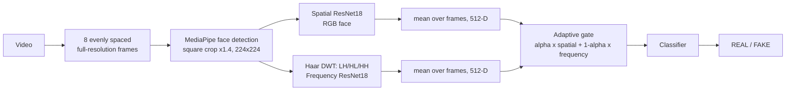

# Multimedia Authentication

Deepfake **video** detection that looks at a face in two complementary ways: **spatial** appearance (RGB) and **frequency** patterns (Haar DWT). Each view goes through its own ResNet18, and an adaptive gate decides how much to trust each one for every video. Trained and evaluated on FaceForensics++ (C23).

> **Research prototype.** This is a mini-project, not a production detector. Results are within-dataset (FaceForensics++); see [Limitations](#limitations).

<!-- Add a screenshot at docs/demo_screenshot.png, then uncomment: -->
<!--  -->

## Pipeline



## Quick start

```bash
git clone https://github.com/kirtisrivastava22/Multimedia-authentication.git
cd Multimedia-authentication
pip install -r requirements.txt
python app.py
```

The trained model is `weights/gated_v2_fp16.pth` (about 45 MB, fp16). The face-detector model is downloaded automatically on first run.

Check that the video path matches the training preprocessing (needs one test clip and its pre-extracted faces):

```bash
python scripts/sanity_check.py clip.mp4 clip.npz
```

## Repository layout

```
app.py                 Gradio demo
src/net.py             Gated fusion network (two ResNet18 backbones + gate + classifier)
src/preprocessing.py   Frame sampling, face crop, Haar DWT (mirrors training)
src/inference.py       DeepfakeDetector (video -> REAL/FAKE + gate weights)
scripts/               export_weights.py, sanity_check.py
results/               Metrics table and evaluation figures
weights/               Exported model weights
```

## Dataset

FaceForensics++ (C23): original videos plus Deepfakes, Face2Face, FaceSwap, FaceShifter and NeuralTextures (DeepFakeDetection excluded). All 6,000 videos were processed; **5,933** had a detectable face and were kept (67 dropped, 1.1%).

| Split | Videos | FAKE | REAL |
|---|---|---|---|
| Train | 4,155 | 3,462 | 693 |
| Validation | 890 | 742 | 148 |
| Test | 888 | 740 | 148 |

Splits are grouped by source video ID (70/15/15), so no source ID appears in more than one split. The dataset is not included in this repository.

## Method

1. **Frames:** 8 evenly spaced frames per video, at native resolution.
2. **Faces:** MediaPipe BlazeFace runs on the full-resolution frame; the face is cropped as a square (1.4x the box) and resized to 224x224. Frames without a detection reuse the nearest detected box.
3. **Spatial branch:** ImageNet-pretrained ResNet18 on RGB faces.
4. **Frequency branch:** single-level Haar DWT; the LH, HL and HH sub-bands (averaged over RGB) are min-max normalised per image and fed to a ResNet18.
5. **Video features:** mean of the 8 frame-level 512-D features per branch.
6. **Gated fusion:** a small network looks at both feature vectors and outputs alpha in (0, 1); the fused feature is `alpha * spatial + (1 - alpha) * frequency`. Trained end-to-end with modality dropout so that both branches stay useful.
7. **Training:** class-weighted cross-entropy, light augmentation (flip, brightness/contrast), AdamW with cosine schedule, checkpoint chosen by validation AUC.

## Results

Test set: 888 videos from source IDs never seen in training (740 FAKE, 148 REAL). Because 83% of the test videos are FAKE, always answering "FAKE" would already score 83% accuracy, so ROC-AUC, REAL recall and balanced accuracy are the numbers to look at. Brackets are 95% bootstrap confidence intervals over videos.

| Model | ROC-AUC | Accuracy | REAL recall | FAKE recall | Balanced acc. |
|---|---|---|---|---|---|
| Spatial ResNet18 | 0.988 (0.979-0.994) | 96.2% | 92.6% | 96.9% | 94.7% |
| Frequency DWT + ResNet18 | 0.969 (0.957-0.980) | 92.6% | 77.7% | 95.5% | 86.6% |
| Late fusion | **0.990** (0.983-0.996) | **96.7%** | 92.6% | **97.6%** | **95.1%** |
| **Gated fusion (used in the app)** | 0.989 (0.981-0.994) | 96.0% | 91.2% | 96.9% | 94.0% |

Gated-fusion confusion matrix on the test set: 135 REAL and 717 FAKE correct, 13 REAL flagged as FAKE, 23 FAKE missed.

What the numbers say:

- Fusion is **statistically indistinguishable** from the spatial branch alone (paired bootstrap differences include zero). Late fusion shows a statistically significant but very small AUC gain (+0.002).
- The frequency branch carries real signal on its own (AUC 0.969, perfect on Deepfakes) but is weaker at recognising REAL videos.
- The gate is input-dependent: mean alpha is 0.70, lower for REAL videos (0.58) than for FAKE ones (0.73), i.e. REAL videos lean more on frequency evidence. It is still spatial-dominant (alpha > 0.5) for every test video.
- NeuralTextures is the hardest manipulation method; see `results/figs/per_method_v2.png`.

Figures and the metrics CSV are in [`results/`](results/).

### Earlier version (v1)

A first version used low-resolution face crops, a subset of 2,647 videos and frozen-feature fusion. On its own 418-video test set it reached ROC-AUC 0.805 and 50% REAL recall, and the frequency branch had collapsed to "always FAKE". The diagnosis (faces detected after shrinking the frame to 224x224, checkpoint selection by F1, a gate trained on frozen features) led to the rebuild described above. v1 and v2 used different test sets, so these numbers are indicative rather than a strict head-to-head.

## Limitations

- **Within-dataset only:** all results are on FaceForensics++ C23. There is no evaluation on Celeb-DF, DFDC or other sources, nor on unseen manipulation methods, so generalisation is untested.
- **Fusion adds little here:** the gated model matches the spatial branch rather than beating it.
- **REAL videos are the minority** (about 17%), and REAL recall (91%) is lower than FAKE recall (97%).
- **Identity overlap:** splits group by the first ID in `A_B.mp4`; the official FaceForensics++ splits keep both IDs together, so some identity overlap between splits is possible.
- **Dropped videos:** 67 videos (1.1%) had no detectable face and were excluded.
- **Compression:** C23 only; behaviour on heavier social-media re-encoding is unknown.

## Future work

Cross-dataset evaluation (Celeb-DF, DFDC), official FF++ splits, richer frequency features, and calibration of the output probabilities.

## License

MIT, see [LICENSE](LICENSE). FaceForensics++ is subject to its own terms of use.
